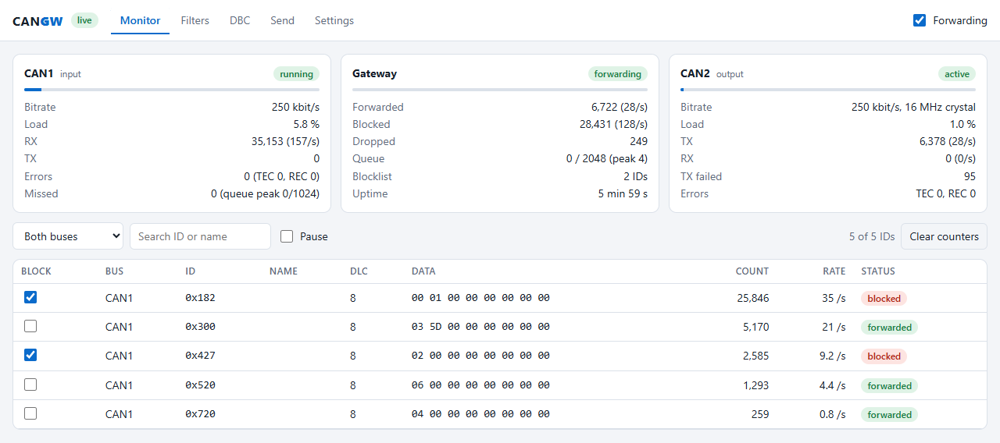

# esp32s3-can-gateway

A one-way CAN gateway for the [Waveshare ESP32-S3-CAN-2CH](https://www.waveshare.com/esp32-s3-can-2ch.htm).
Every frame received on **CAN1** is forwarded to **CAN2**, except the IDs on a
blocklist that you edit from a web page, the serial console or a REST API.

- Standard and extended frames, remote frames included, forwarded in arrival order
- Blocklist changes apply to the very next frame and are saved automatically
- Live monitor: per-ID count, rate and last data for both buses, bus load, error counters
- Optional DBC file per bus, decoded in the browser (message names and signal values)
- Independent bitrates (25 to 1000 kbit/s), CAN1 listen-only mode, forwarding master switch
- Test-frame sender, config export/import, firmware update from the browser with rollback
- Wi-Fi station with fallback to its own access point, `cangw.local` via mDNS

CAN2 traffic is shown in the monitor but is never forwarded back to CAN1.
Out of the box, `0x182` and `0x427` are blocked and both buses run at 250 kbit/s.

A step-by-step guide to the web page, with screenshots, is in
[docs/HOW_TO_USE.md](docs/HOW_TO_USE.md). Design notes are in
[docs/ARCHITECTURE.md](docs/ARCHITECTURE.md).



## Hardware

| | |
|---|---|
| CAN1 (input) | ESP32-S3 TWAI controller, TX GPIO15, RX GPIO16 |
| CAN2 (output) | XL2515 (MCP2515-compatible) on SPI: CS 17, INT 18, SCLK 21, MOSI 41, MISO 42 |
| Button | BOOT (GPIO0): hold 5 s while running to restore factory defaults |

Each CAN bus needs 120 Ω at both ends. The board has a termination jumper per
channel; neither is fitted from the factory. CAN FD is not supported.

## Build and flash

You need [PlatformIO](https://platformio.org/install/cli). The first build
downloads ESP-IDF 5.5 and takes a few minutes.

```sh
pio run                                    # build
pio run -t upload --upload-port COM12      # flash (use your port; /dev/ttyACM0 on Linux)
pio device monitor --port COM12            # serial console
```

Instead of `--upload-port` you can set the `PLATFORMIO_UPLOAD_PORT` environment
variable. The board's USB-C port is the ESP32-S3's built-in USB serial, so no
driver is needed. If it does not enter the bootloader by itself, hold BOOT,
tap RESET, release BOOT, then flash.

## First start

1. With no Wi-Fi configured, the gateway opens an access point named
   `CAN-Filter-XXXX` (password `vtron123`). Join it and open <http://192.168.4.1>.
2. Under **Settings → Wi-Fi**, enter your network. The gateway reboots and
   joins it; open <http://cangw.local> or the address shown by `status` on the
   serial console. It keeps trying to join that network for as long as it
   takes. While the network has been unreachable for 20 s (wrong password,
   router still starting after a power cut), the access point is open as well,
   and it closes again once the gateway is connected.
3. Under **Settings → Admin password**, set a password if other people share
   the network. Without one, anyone who can reach the page can change settings.
   With one, the page is read-only until you log in.

Forwarding starts as soon as the board has power. It does not wait for Wi-Fi.

## Web page

| Tab | What it does |
|---|---|
| **Monitor** | Bus and gateway cards, and a table of every ID seen. Tick **Block** on a CAN1 row to stop forwarding that ID. Click a row to see its decoded signals. |
| **Filters** | The blocklist: add an ID in hex, remove one, or search the CAN1 DBC by message name. |
| **DBC** | Upload, replace or delete the DBC file for each bus. |
| **Send** | Send a test frame on either bus, once or repeatedly. |
| **Settings** | Bitrates, listen-only, Wi-Fi, access point password, admin password, config export/import, firmware update, reboot, factory reset. |

See [docs/HOW_TO_USE.md](docs/HOW_TO_USE.md) for a walkthrough of each tab.

## Serial console

Open the USB port at any baud rate and type `help`.

| Command | |
|---|---|
| `status` | Buses, counters, queue peaks, Wi-Fi, cause of the last restart |
| `clear` | Clear the per-ID table and the queue peak marks |
| `block <id>` / `unblock <id>` | Hex ID. Append `x` for an extended ID below 0x800, e.g. `block 182x` |
| `list` | Show the blocklist |
| `bitrate <1\|2> <kbps>` | 25, 50, 100, 125, 250, 500, 800 or 1000 |
| `listen on\|off` | CAN1 listen-only mode |
| `fwd on\|off` | Forwarding master switch |
| `send <1\|2> <id> [data]` | Test frame, e.g. `send 2 123 DEADBEEF` |
| `wifi <ssid> [password]` | Save credentials and reboot (`wifi ""` clears them) |
| `appass <password>` | Set the access point password (8 to 63 characters) and reboot |
| `password <new>\|off` | Set or remove the web admin password |
| `xtal <0\|8\|12\|16\|20>` | XL2515 crystal in MHz; 0 detects it at start-up (the default) |
| `factory-reset`, `reboot` | |

## REST API

Requests that change something must carry the header `X-CANGW: 1` and, when an
admin password is set, the session cookie from `/api/login`. IDs are JSON
numbers or hex strings (`386` or `"0x182"`).

| Method | Path | Body or result |
|---|---|---|
| GET | `/api/status` | Version, uptime, Wi-Fi, bus states, counters |
| GET, PUT | `/api/config` | Whole configuration as JSON (export/import, passwords excluded) |
| GET | `/api/filters` | `[{"id": 386, "ext": false}, ...]` |
| POST, DELETE | `/api/filters` | `{"id": "0x182", "ext": false}`; DELETE also takes `{"all": true}` |
| PUT | `/api/bus/1` | `{"bitrate": 500, "listen_only": false}` |
| PUT | `/api/bus/2` | `{"bitrate": 500, "xtal_mhz": 0}` |
| PUT | `/api/forwarding` | `{"enabled": true}` |
| POST | `/api/tx` | `{"bus": 2, "id": "0x123", "ext": false, "rtr": false, "data": "11 22 33"}` |
| GET, PUT, DELETE | `/api/dbc/1`, `/api/dbc/2` | Raw DBC file |
| POST | `/api/ota` | Firmware `.bin` as the request body |
| POST | `/api/login`, `/api/logout` | `{"password": "..."}` |
| PUT | `/api/password`, `/api/wifi` | `{"password": "..."}`, `{"ssid": "...", "password": "..."}` |
| PUT | `/api/ap-password` | `{"password": "..."}` (8 to 63 characters); reboots |
| POST | `/api/stats/clear`, `/api/reboot`, `/api/factory-reset` | |
| WebSocket | `/ws` | Server to client, about 4 times a second: counters, and the per-ID rows that changed |

```sh
curl -X POST http://cangw.local/api/filters -H "X-CANGW: 1" -d '{"id":"0x2A0","ext":false}'
```

## Firmware update

**Settings → Firmware update** takes `.pio/build/esp32s3/firmware.bin`. The new
image is confirmed only after CAN and the web server have started; if it fails
to get that far, the next reset boots the previous image again.

## Behaviour worth knowing

- **Ordering.** Frames leave on CAN2 in the order they arrived on CAN1.
- **Overload.** CAN1 reception never waits for CAN2. If CAN2 cannot keep up
  (slower bitrate, nothing acknowledging, bus fault) up to 2048 frames are
  queued and the rest are counted as *dropped*.
- **Flash writes pause forwarding.** Saving settings, uploading a DBC file and
  updating the firmware write to flash, which stops both CPU cores for a few
  to a few tens of milliseconds at a time. Frames received on CAN1 meanwhile
  wait in a 1024-frame queue (about 450 ms of full load at 250 kbit/s, 130 ms
  at 1 Mbit/s) and go out on CAN2 afterwards, so nothing is lost, but CAN2
  falls silent for that moment. A firmware update or DBC upload at high bus
  load can overflow the queues; do those during maintenance. `status` shows
  the peak fill of both queues, so you can see how much margin is left.
- **Watchdog.** If a task stops responding for 5 s, the gateway restarts and
  forwards again about 1 s later. `status` and the Settings page show the
  cause of the last restart (power on, brownout, task watchdog, crash, ...).
- **Firmware updates keep settings.** Each setting is stored separately, so
  a newer firmware that adds settings keeps the existing ones.
- **Unplugged CAN2.** A frame that cannot be sent within 100 ms is abandoned
  together with the stale queue, so old frames are not replayed on reconnect.
- **Bus-off.** Both controllers recover by themselves; the events are counted.
- **Listen-only.** In listen-only mode CAN1 does not acknowledge frames, so
  another node on that bus has to.
- **Monitor limit.** The table tracks 1024 different IDs per bus. Further IDs
  are still forwarded, just not listed.
- **Access point.** The fallback access point opens by itself whenever the
  configured network is unreachable. Its password (WPA2) is `vtron123` until
  you change it under **Settings → Access point password** or with `appass`;
  a factory reset restores it. The name prefix and the default password are
  `AP_SSID_PREFIX` and `AP_PASS_DEFAULT` in `src/config.h`. Change the
  default password on any installed gateway and set an admin password;
  without one, anyone who joins the access point can change the
  blocklist.

## Tests

Host tests (filter, ring buffer, bit timing, config JSON, DBC decoder), no
hardware needed:

```sh
python test/run_tests.py
```

This needs Node.js and a C compiler (gcc, clang, or `pip install ziglang`).

Bench tests with one or two CAN adapters (PEAK PCAN-USB by default, anything
python-can supports via `--interface`):

```sh
pip install -r tools/requirements.txt
python tools/can_test.py --channel PCAN_USBBUS1 --rx-channel PCAN_USBBUS2 --host cangw.local all
python tools/can_test.py --channel PCAN_USBBUS1 --port COM12 sweep burst     # one adapter
```

`sweep` checks that every ID except the blocked ones comes out on CAN2,
`toggle` blocks and unblocks an ID while it is flowing, `burst` runs the bus at
full load and checks for drops and ordering, and `latency` measures the
forwarding delay. Run `python tools/can_test.py --help` for the options.

To work on the web page without hardware, `python tools/mock_server.py` serves
`web/` with simulated traffic on <http://localhost:8080>.

## License

[GPL-3.0](LICENSE)
