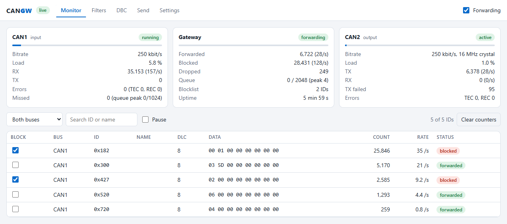
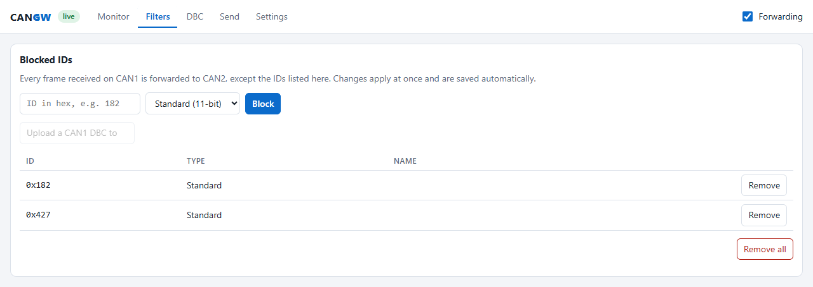
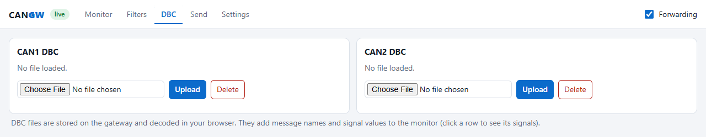
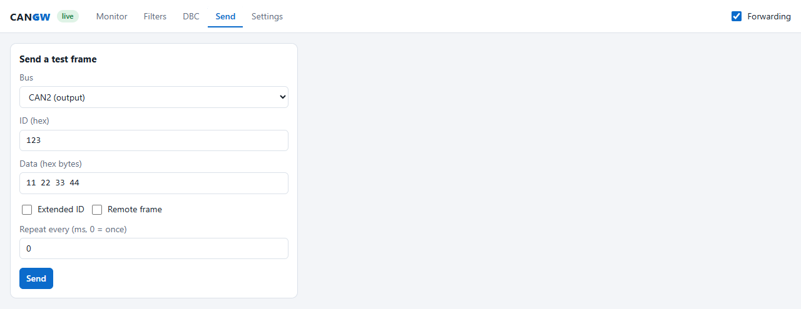
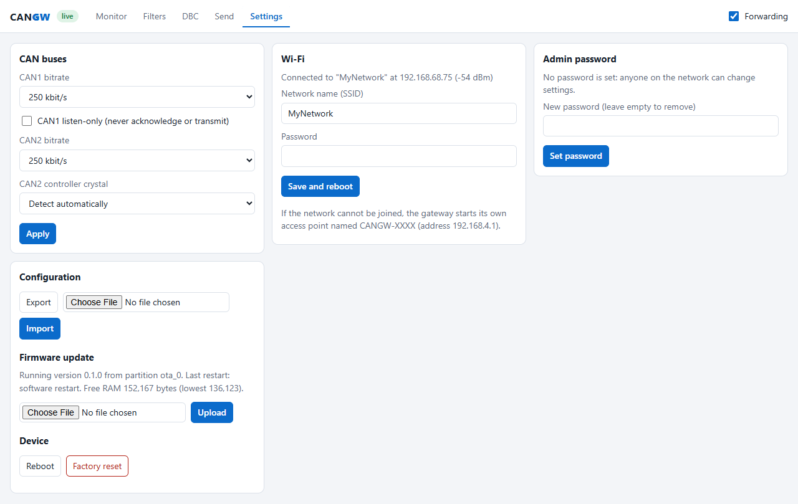

# How to use the gateway

This guide walks through the web page, tab by tab. It assumes the gateway is
flashed and powered (see [Build and flash](../README.md#build-and-flash) in the
README). Everything shown here can also be done from the
[serial console](../README.md#serial-console) or the
[REST API](../README.md#rest-api).

## 1. Connect

1. **First time, no Wi-Fi configured:** join the access point
   `CAN-Filter-XXXX` (password `vtron123`) and browse to <http://192.168.4.1>.
2. **On your network:** browse to <http://cangw.local>, or to the IP address
   the gateway got from your router (type `status` on the serial console to
   see it).

The pill next to the **CANGW** logo shows the live connection: **live** while
the page is receiving updates, **offline** if the gateway is unreachable. The
page reconnects by itself.

If an admin password is set, the page opens read-only. Click **Log in** at the
top right to change anything.

## 2. Monitor: watch both buses

The three cards at the top summarise the system:

| Card | What to look at |
|---|---|
| **CAN1 (input)** | Bitrate, bus load (also the bar under the title), frames received, error counters. **Missed** counts frames the controller could not take in; it should stay 0. |
| **Gateway** | **Forwarded** and **Blocked** frames with their current rate, **Dropped** frames (CAN2 could not keep up), the CAN2 queue fill and its peak, the number of blocked IDs, and uptime. |
| **CAN2 (output)** | Bitrate and detected crystal, load, frames sent, **TX failed** (frames abandoned because nothing acknowledged them in 100 ms), error counters. |

Below the cards is a table with one row per CAN ID seen: data length, last
data bytes, total count and current rate. Rows for IDs that have gone quiet
for more than 2.5 s are greyed out and show a rate of 0.

- **Bus selector:** show CAN1, CAN2 (frames received on the output bus) or
  both.
- **Search:** filter by hex ID (`18`, `0x182`) or, with a DBC loaded, by
  message name.
- **Pause:** freeze the table to read it. Counting continues in the
  background.
- **Clear counters:** reset the table and the queue peak marks.

The **Status** column tells you what happens to each CAN1 ID:
**forwarded**, **blocked**, or **not forwarded** when the master switch is
off. CAN2 rows say **monitor only**, because CAN2 traffic is never sent back
to CAN1.

**To block an ID, tick its Block box.** The change applies to the very next
frame and is saved immediately. Untick to forward it again.

**To see decoded signals, click a row.** This needs a DBC file for that bus
(see [DBC](#4-dbc-decode-messages-and-signals)); without one the row says so.

### Forwarding master switch

The **Forwarding** switch at the top right of every tab stops or resumes all
forwarding from CAN1 to CAN2. CAN1 is still monitored while it is off.

## 3. Filters: manage the blocklist

Every frame received on CAN1 is forwarded to CAN2 except the IDs listed here.

- **Add an ID:** type it in hex (`182`, `0x2A0`, `18FF50E5`), choose
  **Standard (11-bit)** or **Extended (29-bit)**, and click **Block**.
  Standard IDs go up to `7FF`, extended IDs up to `1FFFFFFF`. A standard and
  an extended frame with the same number are different IDs.
- **Find an ID by name:** with a CAN1 DBC loaded, type part of a message
  name in the search box and click **Block** or **Unblock** next to the
  result.
- **Remove an ID:** click **Remove** on its row. **Remove all** clears the
  whole list after asking for confirmation.

The defaults after a factory reset are `0x182` and `0x427`.

## 4. DBC: decode messages and signals

You can store one DBC file per bus on the gateway. The gateway itself does
not use them; your browser does, to add message names to the monitor and the
blocklist, and to decode signal values when you click a monitor row.

1. Click **Choose File**, pick a `.dbc` file, and click **Upload**.
   The panel then shows how many messages and signals the file holds.
2. To replace a file, upload a new one. To remove it, click **Delete**.

Uploading writes to flash, which pauses CAN2 output briefly (see
[Behaviour worth knowing](../README.md#behaviour-worth-knowing)). Do it when
the bus is quiet if you can.

## 5. Send: inject a test frame

Use this to check wiring and termination, or to wake up a node.

1. Choose the **Bus**. CAN2 is the default, so you can test the output
   without disturbing the input bus.
2. Enter the **ID** in hex and the **Data** as hex bytes (`11 22 33 44` or
   `11223344`, up to 8 bytes).
3. Tick **Extended ID** for a 29-bit ID, or **Remote frame** to send a
   request without data.
4. Leave **Repeat every** at `0` to send once, or enter a period in
   milliseconds (20 or more) to send repeatedly. A **Stop** button appears
   while repeating; leaving the page also stops it.
5. Click **Send**. The counter next to the button shows how many frames went
   out. If no other node acknowledges a frame on CAN2, it shows up as
   **TX failed** on the Monitor tab.

A frame sent on CAN1 is sent by the gateway itself; it is not forwarded to
CAN2.

## 6. Settings

### CAN buses

- **CAN1 / CAN2 bitrate:** 25 to 1000 kbit/s, set independently. If CAN2 is
  slower than CAN1 and the traffic does not fit, frames are queued and then
  counted as **Dropped**.
- **CAN1 listen-only:** the gateway never acknowledges or transmits on CAN1.
  Use it when tapping a bus you must not influence. Another node on CAN1 has
  to acknowledge frames.
- **CAN2 controller crystal:** leave on **Detect automatically** unless the
  CAN2 bitrate is wrong; then set it to the crystal fitted on your board.

Click **Apply** to use the new values. They are saved at once.

### Wi-Fi

The line at the top shows the network the gateway is on, its address and the
signal strength. Enter a network name and password and click
**Save and reboot**. Leave the name empty to clear the credentials and go back
to access point mode.

If the network is unreachable for 20 s, the gateway also opens its
`CAN-Filter-XXXX` access point (address 192.168.4.1) until it reconnects, so you
can always get back in.

### Access point password

The access point uses WPA2 with the password `vtron123` from the factory.
Enter a new one (8 to 63 characters) and click **Save and reboot**; anything
joined to the access point then has to reconnect with the new password. A
factory reset restores `vtron123`.

### Admin password

Set one if anyone else can reach the gateway's network, and always on an
installed unit: anyone who joins the access point can otherwise change the
settings. With a password set,
visitors see the page read-only until they log in. Leave the field empty and
click **Set password** to remove it.

### Configuration

- **Export** downloads `cangw-config.json` with bitrates, blocklist and other
  settings (passwords are not included).
- **Import** loads such a file into the gateway. Use it to back up a setup or
  copy it to a second gateway.

### Firmware update

The line under the heading shows the running version, the flash partition,
the cause of the last restart and free memory. Choose a `firmware.bin` (from
`.pio/build/esp32s3/` after `pio run`) and click **Upload**. Settings are
kept. If the new firmware fails to start CAN and the web server, the next
reset goes back to the previous version.

Updating writes a lot to flash; do it while the bus is quiet.

### Device

- **Reboot:** forwarding resumes about one second after the restart.
- **Factory reset:** erases bitrates, blocklist, Wi-Fi and password, then
  reboots. Holding the **BOOT** button for 5 s while the gateway is running
  does the same, which helps if you are locked out.

## Troubleshooting

| Symptom | Check |
|---|---|
| Page shows **offline** | Is the gateway powered and on the same network? Try its IP address instead of `cangw.local`; some systems do not resolve mDNS names. |
| CAN1 table stays empty | Bitrate matches the bus? 120 Ω termination at both ends of the bus? With listen-only on, is another node acknowledging? |
| **TX failed** rising on CAN2 | Nothing on CAN2 acknowledges: check wiring, termination, bitrate, and that at least one other node is powered. |
| **Dropped** rising | CAN2 is slower than CAN1 or its bus is faulty. Raise the CAN2 bitrate or block IDs you do not need. |
| CAN2 bitrate is off | Set **CAN2 controller crystal** to the value fitted on the board. |
| Forgot the admin password | Hold BOOT for 5 s (factory reset), or type `password off` on the serial console. |
